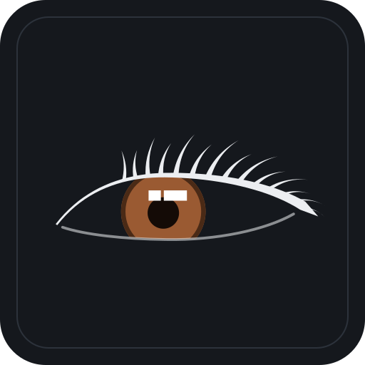

# BIMOFFICE: COORDIX

Coordenação BIM e detecção de interferências (clash detection) em modelos IFC, organizada por projeto. O COORDIX faz parte do ecossistema BIMOFFICE e antes se chamava BIMORA.

Fluxo: **detectar → interpretar → classificar → atribuir → revisar → validar → gerar BCF → acompanhar a resolução**.
A automação faz a parte repetitiva e o coordenador BIM continua responsável pela validação final.

<p></p>

> **Status:** protótipo funcional, versão **2.3** (veja o [histórico de versões](#histórico-de-versões)). Roda inteiro no navegador. Os modelos IFC não ficam salvos entre sessões. O backend em Python está planejado (veja o roteiro abaixo).

## O que já funciona

| Módulo | Recursos |
|---|---|
| Projeto e equipe | Projetos separados, integrantes com cargo, códigos de disciplina e e-mail, indicação do coordenador |
| Modelos IFC | Upload por arrastar e soltar, disciplina detectada pelo código no nome do arquivo (EST, ARQ, SAN, ELE, SCE, PCI, CLI…), esquema IFC e entidades ignoradas na leitura |
| Visualizador | 3D com árvore modelo → pavimento → entidade, isolar, aproximar e snapshot |
| Propriedades | Aba **Geral** no padrão Visus (Disciplina, **Entidade**, ID IFC, Layer, Pavimento, Type) e aba **PropertySets** com quantitativos e propriedades do tipo |
| Regras de análise | Matriz de tolerância com os 21 testes do manual corporativo (interferência ou folga, em mm), filtros de exclusão por entidade ou PropertySet, ordem de flexibilidade das disciplinas e tabela de nomes de Entidade editável |
| Clash detection | Núcleo geométrico próprio (`coordix-geometria.js`): classificação topológica das malhas (sólido válido, aberta, inválida), espessura de interferência rigorosa (exata para peças convexas) ou estimada quando a malha não é sólida, volume de interseção, folga por distância exata, integridade geométrica por elemento, índice espacial (BVH) em cada malha, unidade declarada no IFC e estados de confiabilidade (confirmado, abaixo da tolerância, contato, sem conflito, inconclusivo e incompleto) |
| Clashes por nível | Resultados agrupados por pavimento, aba separada de **falsos clashes** e alerta de revisão pendente |
| Pré-classificação | Regras P1, P2, P3, P4, INFO e Falso clash com o motivo exibido, além do responsável sugerido pela disciplina que se adapta |
| Revisão | Fila um por um, câmera no conflito (A em vermelho, B em azul), PropertySets dos dois elementos, alteração de classificação e responsável, comentários, snapshot e histórico. Atalhos: `Enter`, `F`, `1`–`5`, `←` `→` |
| Issues | Clash validado vira issue com status, prazo do manual e histórico |
| BCF 2.1 | Prévia do `markup.bcf` e do `.bcfv` (GUIDs, cores, câmera, prioridade "P2 - Alto", AssignedTo, Labels = pavimento). A geração do arquivo `.bcf` ainda não está ativa |
| Interface | Identidade "Industrial Precision" com símbolo próprio (olho estilizado), modo claro e escuro com a preferência salva, e ambiente 3D com cores próprias que não mudam com o tema |

## Histórico de versões

Os números de versão abaixo organizam as entregas; cada uma corresponde a commits na `main` e tem relatório em `docs/`.

### v1 · BIMORA (06/11/2026)
Primeiro protótipo, publicado como BIMORA.
- Projetos separados, com equipe, cargos, disciplinas e coordenador.
- Upload de IFC com disciplina detectada pelo nome do arquivo, visualizador 3D e árvore modelo → pavimento → entidade.
- Propriedades no padrão Visus (aba Geral com **Entidade**) e PropertySets, com filtros de exclusão por entidade ou PropertySet.
- Matriz com os 21 testes do manual corporativo e tolerâncias em mm.
- Detecção de clashes, agrupamento por pavimento, pré-classificação P1–P4 / INFO / Falso clash com responsável sugerido, aba de falsos clashes e alerta de revisão.
- Revisão um por um com câmera no conflito, issues e prévia do BCF 2.1.
- Ajustes feitos durante os testes com modelos reais: leitura do modelo de estrutura metálica e correção de um falso clash entre tubulação e pilarete que aparecia mesmo com as peças afastadas.

### v2.0 · COORDIX, Fase 01: confiabilidade do núcleo geométrico (07/11/2026)
- Novo nome: **BIMOFFICE: COORDIX**.
- Núcleo geométrico separado (`coordix-geometria.js`), em precisão dupla e sem dependências.
- Penetração medida como espessura real da interferência (não mais pela caixa dos pontos), contato tratado à parte, sem folga arbitrária na tolerância.
- Fim dos cortes silenciosos: limites com aviso, e estados de confiabilidade (confirmado, abaixo da tolerância, contato, sem conflito, inconclusivo, incompleto).
- Suíte de 53 cenários e comparativo com a v1 (21 de 21 decisões corretas, contra 18 de 21 da v1).
- Relatório: `docs/fase-01-relatorio.md`.

### v2.1 · Fase 01, rodada complementar (07/11/2026)
- Classificação topológica das malhas (sólido válido, aberta, inválida, superfície), com vazios internos reconhecidos.
- Espessura exata para peças convexas e limites garantidos para as demais; volume de interseção.
- Malhas que não são sólidos continuam detectando conflitos reais pelo cruzamento de superfícies e pela distância exata, em vez de virarem inconclusivas.
- Unidade lida do próprio IFC, verificação de escala e integridade geométrica por elemento (completa, parcial, não processada).
- 101 cenários aprovados.
- Relatório: `docs/fase-01-rodada-complementar.md`.

### v2.2 · Fase 02, Marco 1: BVH por elemento (07/11/2026)
- Índice espacial (BVH) em cada malha, construído uma vez e reutilizado, sem duplicar geometria.
- As consultas do núcleo passaram a usar a BVH com os mesmos resultados de antes: nenhum estado, valor ou classificação mudou (verificado nos 101 cenários e em 81 testes novos de equivalência).
- Medido: consultas em malhas de 43 200 triângulos de 190× a 3 400× mais rápidas; um par viga I × pilar caiu de 5 002 ms para 42 ms; a suíte completa, de cerca de 1,3 s para 0,7 s.
- Relatório: `docs/fase-02-marco-01-bvh.md`.

### v2.3 · Nova identidade visual "Industrial Precision" (07/11/2026)
- Interface redesenhada como prancha técnica: painéis com cabeçalho em faixa, fios em vez de sombras, tipografia IBM Plex em três vozes e cor de destaque cobre.
- Novo símbolo: olho vetorial desenhado a partir de uma fotografia de referência (cílios, íris castanha, pupila e o reflexo retangular da janela), alinhado entre COORDIX e BIMOFFICE na barra superior. Arquivos em `marca/`.
- Modo claro e escuro com botão na barra superior; a preferência fica salva e é aplicada ao abrir.
- Linguagem própria para severidade, status e revisão; pavimentos com o triângulo de nível dos desenhos de arquitetura; grade técnica no 3D.
- Todas as funcionalidades preservadas; núcleo geométrico sem alteração.
- Relatório: `docs/redesign-industrial-precision.md`.

## Como rodar

O app é estático: basta servir a pasta por HTTP. Abrir o `index.html` direto do disco não funciona, porque o navegador bloqueia o carregamento do `.wasm`.

```bash
python -m http.server 8000
# abra http://localhost:8000
```

Também roda no **GitHub Pages**: em *Settings → Pages*, escolha a branch `main` e a pasta `/ (root)`.

Na primeira abertura é carregado um projeto de exemplo, com modelos fictícios da pasta `exemplos/`. Os dados de projetos, equipe, regras e decisões ficam no `localStorage` do navegador.

## Estrutura

```
index.html                       app (interface, leitura IFC, análise, revisão, BCF)
coordix-geometria.js             núcleo geométrico (sem dependências; navegador e Node)
web-ifc.wasm                     motor de leitura IFC (web-ifc 0.0.39)
exemplos/                        IFCs fictícios com conflitos planejados
ferramentas/gerar_ifc_exemplo.py gera os IFCs de exemplo
ferramentas/gerar_simbolo.py     gera o símbolo do COORDIX (SVG)
marca/                           símbolo, versão com sobrancelha e ícone do aplicativo
testes/geometria.test.js         suíte de testes geométricos (101 cenários)
testes/bvh.test.js               testes da BVH: estrutura e equivalência com o núcleo da Fase 01
testes/desempenho_bvh.js         medição de desempenho (linear × BVH SAH × BVH mediana)
testes/legado_fase01.js          núcleo da Fase 01 congelado, referência dos testes de equivalência
testes/comparativo_v1.js         comparativo com o motor da v1 nos mesmos cenários
testes/formas.js                 geometrias sintéticas dos testes
testes/legado_v1.js              motor da v1, preservado só para o comparativo
docs/fase-01-relatorio.md        relatório técnico da Fase 01
docs/fase-01-rodada-complementar.md  correções da revisão técnica da Fase 01
docs/fase-02-marco-01-bvh.md     relatório da Fase 02 · Marco 1 (BVH por elemento)
docs/redesign-industrial-precision.md  identidade visual, sistema de design e temas
```

## Testes

Precisa do Node.js 18 ou superior. Não há dependências para instalar.

```bash
node testes/geometria.test.js    # sai com código 1 se algum cenário falhar
node testes/comparativo_v1.js
node testes/bvh.test.js          # equivalência da BVH com o núcleo linear (~1 min)
node testes/desempenho_bvh.js    # tempos medidos na sua máquina
```

Bibliotecas carregadas por CDN: three.js 0.147 e web-ifc 0.0.39.

## Roteiro

1. Backend em Python (FastAPI + IfcOpenShell) com banco PostgreSQL, armazenamento dos IFCs e das versões, e login por papel.
2. Fase 02: ~~BVH por elemento (Marco 1)~~ concluído; índice espacial entre elementos (Marco 2), análise em segundo plano com Web Worker (Marco 3), decomposição convexa (Marco 4) e junções em T (Marco 5).
3. Atribuição de pavimento pela cota para modelos sem pavimentos reais (por exemplo, estrutura metálica em "Default Storey").
4. Geração do arquivo BCF 2.1 e validação da importação no Trimble Connect.
5. Revisão dos nomes de Entidade conforme o Visus.

## Licenças de terceiros

`web-ifc.wasm` faz parte do [web-ifc](https://github.com/ThatOpen/engine_web-ifc) (That Open Company), distribuído sob a licença MPL-2.0. O three.js é distribuído sob a licença MIT.
